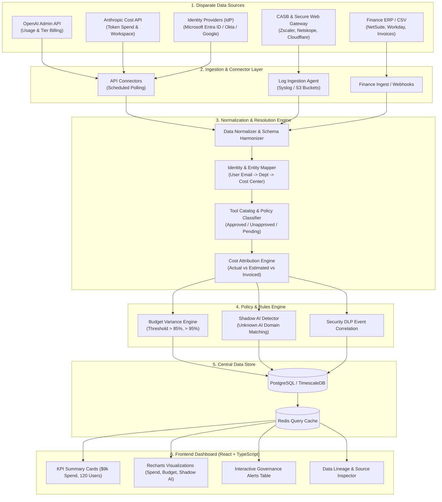

# Architecture & Product Specification: AI Governance Dashboard

**Project Name:** AI Governance Dashboard  
**Assignment Type:** APM Take-Home Assignment  
**Author Roles:** Senior Product Manager, UI/UX Designer & Full-Stack Developer  
**Status:** Architecture Baseline & Specification  
**Version:** 1.0.0  
**Target Environment:** React + TypeScript + Tailwind CSS Prototype  

---

## Executive Summary

As enterprise adoption of generative AI accelerates, organizations face two competing forces: business units rapidly adopting AI tools to drive productivity, juxtaposed against finance and security teams struggling to maintain cost control, data confidentiality, and compliance. This unchecked adoption leads directly to **Shadow AI**—unauthorized or unmonitored use of external AI models, SaaS assistants, and developer APIs.

The **AI Governance Dashboard** provides cross-functional leadership (specifically Chief Financial Officers and IT/Security Leads) with a single pane of glass to:
1. **Track and control AI spending** across direct API consumption and enterprise SaaS subscriptions against budgeted limits.
2. **Discover and classify AI applications** running across the corporate perimeter (approved, unapproved, and shadow tools).
3. **Proactively mitigate governance and compliance risks** through real-time policy alerts, threshold breach warnings, and data security monitoring.

---

## 1. Stakeholder & Target User Analysis

| User Persona | Core Responsibilities | Key Dashboard Needs | Primary Friction Points Solved |
| :--- | :--- | :--- | :--- |
| **Chief Financial Officer (CFO)** | Financial planning, cost containment, vendor license procurement, budget reconciliation. | • Total AI expenditure across all business units.<br>• Budget utilization vs. allocated spend.<br>• Monthly spend velocity and forecast overruns. | Eliminates surprise end-of-month cloud bills; distinguishes between API metered usage and fixed SaaS seat licenses. |
| **IT & Security Lead (CISO / SecOps)** | Perimeter security, DLP (Data Loss Prevention), identity management, regulatory compliance (SOC 2, GDPR, HIPAA). | • Full discovery of authorized vs. unauthorized AI endpoints.<br>• Shadow AI detection across corporate networks.<br>• Policy breach alerts (e.g. PII ingestion, unvetted models). | Replaces fragmented proxy logs with automated discovery; enables rapid policy enforcement and auditing. |
| **Department Head (Engineering / Marketing / Ops)** | Team productivity, resource allocation, tooling enablement. | • Departmental AI budget status.<br>• Approval workflows for new AI tool requests.<br>• Tool utilization efficiency. | Clear visibility into remaining budget without waiting for monthly accounting close cycles. |

---

## 2. Core Functional Requirements & Product Logic

### 2.1 Financial & Budget Computations

The core financial monitoring engine reconciles allocated departmental/tool budgets against recorded expenditures:

$$\text{Budget Utilization (\%)} = \left( \frac{\text{Actual Spending}}{\text{Allocated Budget}} \right) \times 100$$

#### Baseline Enterprise Demo Data Parameters:
* **Allocated Total AI Budget:** \$12,000 / month
* **Actual Recorded AI Spend:** \$9,000 / month
* **Computed Global Utilization:** **75.0%**
* **Active User Population:** 120 employees actively using enterprise-provisioned AI tools
* **Total AI Tools Detected in Perimeter:** 11 distinct tools
* **Active Governance / Policy Alerts:** 5 open incidents

#### Threshold & Alert Trigger Rules:
1. **Warning Threshold (Budget):** Trigger `Warning` alert when tool or department spend reaches $\ge 85\%$ of allocated budget.
2. **Critical Threshold (Budget):** Trigger `Critical` alert when spend reaches $\ge 95\%$ or exceeds ($> 100\%$) budget.
3. **Shadow AI Detection:** Automatically generate a `Critical` or `High` alert whenever corporate network traffic or IdP authentication identifies an AI tool classified as `Unapproved`.
4. **Data Security Policy Event:** Trigger `High` severity alert upon detection of unauthorized API keys or sensitive data exposure patterns flagged by CASB or Secure Web Gateways.

---

## 3. Selected Visualizations & Business Justification

To prevent executive cognitive overload while answering the primary questions of both CFO and CISO personas, exactly **three core charts** are implemented:

```
+--------------------------------------------------------------------------------------------------+
|                                    THREE CORE VISUALIZATIONS                                     |
+------------------------------------+-----------------------------------+-------------------------+
| [1] AI Spending by Tool            | [2] Actual Spending vs. Budget    | [3] Approved vs.        |
|     (Horizontal / Vertical Bar)    |     (Grouped Bar Chart)           |     Unapproved AI Usage |
|                                    |                                   |     (Donut Chart)       |
| • Focus: Cost Concentration        | • Focus: Financial Variance       | • Focus: Shadow AI Risk |
| • Primary Owner: CFO               | • Primary Owner: CFO & IT Ops     | • Primary Owner: CISO   |
+------------------------------------+-----------------------------------+-------------------------+
```

### Chart 1: AI Spending by Tool (Bar Chart)
* **Visual Type:** Bar Chart
* **Data Breakdown:**
  * ChatGPT: \$4,000
  * Claude: \$2,500
  * GitHub Copilot: \$1,500
  * Other AI Services: \$1,000
  * **Total:** \$9,000
* **Strategic Business Justification:**
  * Provides the CFO with an immediate Pareto distribution of AI costs.
  * Reveals that ChatGPT and Claude account for over 72% of total spend, identifying the prime targets for volume discount negotiations, enterprise tier consolidation, and centralized procurement.

### Chart 2: Actual Spending vs. Budget (Grouped Bar Chart)
* **Visual Type:** Grouped / Paired Bar Chart
* **Data Breakdown:**
  * **ChatGPT:** Budget \$5,000 | Actual \$4,000 *(80% utilization)*
  * **Claude:** Budget \$3,000 | Actual \$2,500 *(83.3% utilization)*
  * **GitHub Copilot:** Budget \$2,000 | Actual \$1,500 *(75% utilization)*
  * **Other AI Services:** Budget \$2,000 | Actual \$1,000 *(50% utilization)*
* **Strategic Business Justification:**
  * Allows executives to evaluate fiscal discipline tool-by-tool rather than relying solely on high-level aggregate numbers.
  * Identifies underutilized allocations (\$1,000 surplus in Other) that can be reallocated to fast-growing tools (Claude / ChatGPT) without expanding the overall corporate AI budget.

### Chart 3: Approved vs. Unapproved AI Usage (Donut Chart)
* **Visual Type:** Donut Chart with Center KPI
* **Data Breakdown:**
  * **Approved Tools:** 75% (measured across active user traffic sessions)
  * **Unapproved Tools:** 25% (Shadow AI exposure)
* **Strategic Business Justification:**
  * Direct risk metric for the IT & Security Lead.
  * Quantifies the scale of Shadow AI: 1 in every 4 AI interactions is happening on unvetted, unapproved platforms that lack enterprise data processing agreements (DPAs), threatening corporate intellectual property and data sovereignty.

---

## 4. End-to-End System & Data Flow Architecture

The dashboard relies on an integrated multi-source ingestion pipeline to harmonize disparate data streams—unifying API billing metrics, network telemetry, enterprise identity, and general ledger expenses.

### 4.1 Architectural Data Flow Diagram



---

## 5. Comprehensive API & Data Source Analysis

### 5.1 Source Breakdown Matrix

| Source Category | Representative Providers | Data Points Ingested | Sync Frequency | Cost Nature |
| :--- | :--- | :--- | :--- | :--- |
| **Direct AI Admin APIs** | OpenAI Admin API, Anthropic Usage/Cost API, Azure OpenAI Service | • Token consumption (prompt/completion)<br>• Workspace/team breakdown<br>• Model IDs (`gpt-4o`, `claude-3-5-sonnet`)<br>• Direct API metered costs | Daily batch / 4-hour incremental | **Actual Metered Spend** |
| **Enterprise Identity (IdP)** | Microsoft Entra ID (Azure AD), Okta, Google Workspace | • Employee active directory metadata<br>• Department & cost center codes<br>• SAML/SSO application assignments<br>• Last login timestamps | Hourly synchronization | **Contextual Metadata** |
| **Network & Perimeter Telemetry** | CASB (Netskope, Zscaler), Secure Web Gateways, Palo Alto Prisma | • Outbound DNS & HTTPS request logs<br>• Domain access counts (`chatgpt.com`, `perplexity.ai`)<br>• Upload byte sizes & user agents<br>• Unmanaged endpoint flags | Near real-time streaming / 15-min logs | **Estimated / Usage Proxy** |
| **Enterprise Finance / ERP** | NetSuite, Workday, SAP, Manual Accounts Payable CSV | • SaaS seat license subscriptions (e.g., Copilot @ \$30/user/mo)<br>• Approved budget allocations per department<br>• Vendor invoices and credit memos | Monthly / Bi-weekly close cycle | **Actual Invoiced Spend & Budgets** |

---

### 5.2 Critical Cost Differentiation: Actual vs. Estimated vs. Unavailable

A major design flaw in naive AI governance tools is assuming all data sources can report dollar costs. The architecture strictly delineates three tiers of financial precision:

```
+----------------------------------------------------------------------------------------------------+
|                                      COST VISIBILITY SPECTRUM                                      |
+------------------------------------+-----------------------------------+---------------------------+
| TIER 1: ACTUAL RECORDED COSTS      | TIER 2: ESTIMATED / MODELLED COST | TIER 3: UNAVAILABLE COST  |
| Source: Vendor APIs & ERP Invoices | Source: Network Log Proxying      | Source: Free Tier Shadow  |
|                                    |                                   | Usage / Raw Web Requests  |
| • Direct API token billing.        | • Seat pricing multiplied by      | • Web visits to consumer  |
| • Formal monthly SaaS seat         |   active SSO user accounts.       |   AI tools (e.g. Free     |
|   invoices (e.g. Copilot M365).    | • Average cost-per-session        |   ChatGPT or Claude Free).|
| • Precision: Exact dollar value.   |   estimates based on traffic.     | • Prompt payloads (TLS).  |
+------------------------------------+-----------------------------------+---------------------------+
```

1. **Actual Costs:** Ingested directly from provider billing APIs (e.g., OpenAI Organization Usage API) or official accounts payable invoices recorded in ERP systems.
2. **Estimated Costs:** Inferred when employees access paid tiers via SSO without granular per-query API metering (e.g., calculating active Copilot seats $\times$ \$30/mo).
3. **Unavailable Costs (Zero-Cost / Shadow AI):** When an employee navigates to an unauthorized free AI site (e.g., free tier ChatGPT, DeepSeek, or Hugging Face spaces), **financial cost is \$0**, but **governance risk is maximum**. Network logs capture the domain hit and payload size, but cannot inspect encrypted payload content or assign financial liability.

---

### 5.3 Technical & Architectural Limitations

1. **Network Logs vs. Prompt Contents (TLS Encryption):**  
   Modern enterprise web traffic is encrypted via TLS 1.3. Secure Web Gateways and CASBs can observe destination FQDNs (e.g., `api.anthropic.com` or `chatgpt.com`) and data volume (bytes uploaded/downloaded). **They cannot and must not decrypt raw prompt contents or extract intellectual property without active SSL-inspection proxies**, which introduce severe legal and privacy concerns.
2. **API Admin Keys vs. Consumer Web Accounts:**  
   The OpenAI/Anthropic APIs only monitor developer API keys configured within an organization's developer console. They have **zero visibility** into employees signing up for personal consumer subscriptions (`chatgpt.com/plus`) using corporate credit cards or personal accounts unless discovered via CASB or corporate expense management.
3. **Rate Limits & Sync Delays:**  
   Vendor billing APIs are generally not real-time; OpenAI and Anthropic usage data typically has a 4-to-24 hour reporting lag. Dashboards must present a clear "Data as of [timestamp]" indicator to avoid misleading real-time financial assertions.

---

## 6. Dashboard Interface & UX Design System

### 6.1 Design Tokens & Guidelines

* **Design Style:** Modern Enterprise SaaS (inspired by Linear, Stripe, and Datadog).
* **Color Palette:**
  * **Primary Navy / Background:** `#0B132B` / `#0F172A` (Slate 900) for deep contrast and structural framing; crisp `#FFFFFF` and `#F8FAFC` (Slate 50) for surface backgrounds in Light theme.
  * **Accent Blue:** `#2563EB` (Blue 600) for primary metrics, active buttons, and budget benchmarks.
  * **Accent Teal:** `#0D9488` (Teal 600) for positive approval statuses and healthy allocations.
  * **Warning Amber:** `#D97706` (Amber 600) for budget warnings ($\ge 80\%$).
  * **Critical Rose / Red:** `#E11D48` (Rose 600) for unapproved shadow AI and policy violations.
* **Typography:** Clean sans-serif system font stack (`Inter`, system-ui, -apple-system).
* **Layout Structure:**
  * **Left Sidebar:** Fixed navigation with links to *Overview*, *AI Applications*, *Spend & Budgets*, *Governance*, and *Data Sources*.
  * **Top Header:** Breadcrumb navigation, organization selector (`Acme Inc. (Demo)`), global date filter (`This Month`), and unambiguous `DEMO DATA` badge.
  * **KPI Summary Grid:** 4-column responsive grid featuring high-level metrics with trend indicators.
  * **Data Visualization Row:** 3 distinct charts arranged with clear visual hierarchy.
  * **Governance Alerts Table:** Comprehensive interactive table with multi-criteria filtering and interactive review toggles.

---

### 6.2 Interactive Governance Alerts Specification

The dashboard includes a dedicated alerts table allowing security and finance analysts to triage issues:

| Severity | AI Tool | Department | Event Description | Date | Status | Action |
| :---: | :---: | :---: | :---: | :---: | :---: | :---: |
| <span style="color:red">● Critical</span> | Jasper AI | Marketing | Unapproved AI application detected via corporate network | Nov 14 | Open | Mark Reviewed |
| <span style="color:orange">● High</span> | Claude API | Engineering | AI spending approaching allocated budget (83.3%) | Nov 13 | In Review | Mark Reviewed |
| <span style="color:red">● Critical</span> | Midjourney | Design | Possible sensitive-data policy event: Large prompt upload | Nov 12 | Open | Mark Reviewed |
| <span style="color:orange">● High</span> | ChatGPT | Sales | Unapproved consumer plus subscription expensed | Nov 11 | Open | Mark Reviewed |
| <span style="color:blue">● Medium</span> | DeepSeek | Research | Unvetted open-weights endpoint accessed via proxy | Nov 10 | Resolved | Reopen |

#### Supported User Interactions:
1. **Severity Filter:** Toggle between All, Critical, High, and Medium.
2. **Tool Filter:** Filter events by specific AI tool (ChatGPT, Claude, Jasper AI, etc.).
3. **Approval Status Filter:** View alerts pertaining to Approved vs. Unapproved tools.
4. **Interactive Action:** Click to update status from "Open" to "Reviewed / Resolved" with persistent visual state.
5. **Data Lineage Modal / Panel:** Inspect the underlying data source powering each alert.

---

## 7. Prototype Technical Architecture & Implementation Plan

### 7.1 Tech Stack Justification

* **Frontend Framework:** React 18 / 19 with TypeScript for strong static typing, ensuring financial formulas and data schemas are bug-free.
* **Styling Engine:** Tailwind CSS for rapid, maintainable design token application following enterprise design principles.
* **Visualization Library:** Recharts (SVG-based, responsive containers, excellent tooltip customization and accessible legend support).
* **Icons:** Lucide-React for crisp, consistent enterprise iconography.
* **State Management:** React hooks (`useMemo`, `useState`) powering real-time local filtering and alert mutations without external database overhead.

---

### 7.2 Directory Structure

```
├── public/
│   └── favicon.ico
├── src/
│   ├── components/
│   │   ├── layout/
│   │   │   ├── Sidebar.tsx
│   │   │   └── Header.tsx
│   │   ├── metrics/
│   │   │   ├── KpiCard.tsx
│   │   │   └── KpiGrid.tsx
│   │   ├── charts/
│   │   │   ├── SpendByToolChart.tsx
│   │   │   ├── BudgetVsActualChart.tsx
│   │   │   └── ShadowAiDonutChart.tsx
│   │   ├── alerts/
│   │   │   ├── AlertsTable.tsx
│   │   │   └── AlertFilterBar.tsx
│   │   └── datasource/
│   │       └── DataSourceModal.tsx
│   ├── types/
│   │   └── dashboard.ts
│   ├── mock/
│   │   └── governanceData.ts
│   ├── App.tsx
│   ├── index.css
│   └── main.tsx
├── architecture.md
├── package.json
├── tailwind.config.js
├── tsconfig.json
└── vite.config.ts
```

---

## 8. Six-Phase Execution Roadmap

The delivery follows a strict sequential roadmap to ensure zero regression and complete coverage of all APM assignment requirements:

```
[Phase 1: Setup & Layout] ➔ [Phase 2: Data & Charts] ➔ [Phase 3: Governance & Alerts]
                                                                  │
[Phase 6: Final PDF]      ⬅ [Phase 5: UI Polish & Test] ⬅ [Phase 4: API Architecture Doc]
```

1. **Phase 1: Project Setup and Dashboard Structure**
   * Initialize lightweight Vite + React + TypeScript + Tailwind CSS workspace.
   * Construct outer app shell: modern enterprise Sidebar and contextual Header with Demo Data markers.
   * Scaffold container grid for KPIs, charts, and alerts.
2. **Phase 2: Dashboard Data & Visualization**
   * Implement 4 core KPI cards (\$9,000 Spend, 120 Users, 11 Tools, 5 Policy Alerts).
   * Implement exactly 3 charts with interactive tooltips, legends, and exact figures.
   * Integrate verifiable financial formulas for budget utilization (\$9,000 / \$12,000 = 75%).
3. **Phase 3: Governance & Interactive Filtering**
   * Build the Governance Alerts table with severity badges, department tags, and status chips.
   * Wire multi-parameter filter controls (Severity, Tool, Status).
   * Implement stateful "Mark as Reviewed" action handler.
   * Add interactive Data Sources information modal.
4. **Phase 4: API Architecture Documentation & Ingestion Blueprint**
   * Complete architectural diagrams and technical documentation covering the 5 data source categories.
   * Formulate clear explanations of cost types (Actual, Estimated, Unavailable) and proxy limitations.
5. **Phase 5: UI Polish, Responsive Verification & Screenshots**
   * Test responsiveness across desktop (1440px), laptop (1024px), and mobile viewports.
   * Verify color contrast ratios and enterprise SaaS styling consistency.
   * Capture high-resolution screenshots for final report integration.
6. **Phase 6: Final Professional PDF Generation**
   * Compile the comprehensive 4–6 page executive report: `AI_Governance_Dashboard_Assignment.pdf`.
   * Structure according to standard APM submission standards (Problem statement, Solution, UI screenshots, API plan, Justifications, MVP assumptions).
   * Validate and verify the generated PDF file.

---

## 9. Security, Privacy & Compliance Foundations

1. **Data Minimization:** No raw prompt texts or employee PII are stored in the centralized governance index; only sanitized metadata (timestamps, token counts, model names, user IDs) are ingested.
2. **Role-Based Access Control (RBAC):**
   * *CFO / Finance:* Read access to spending, invoices, and budget forecasts; masked security event details.
   * *IT Security / CISO:* Full access to Shadow AI logs, security policy alerts, and domain discovery; aggregated spending view.
3. **Audit Trail Immutability:** All alert status changes (e.g. marking an alert as "Reviewed") are recorded with analyst timestamp and ID for SOC 2 Type II compliance readiness.

---

## 10. Document Sign-Off & Verification

* **Objective Alignment:** 100% compliant with APM Take-Home requirements.
* **Prototype Boundary:** Confined to high-fidelity frontend interactive demonstration; all external APIs simulated via high-fidelity, deterministic mock stores.
* **Next Immediate Step:** Execution of Phase 1 (Vite + React scaffold and Dashboard shell creation).
